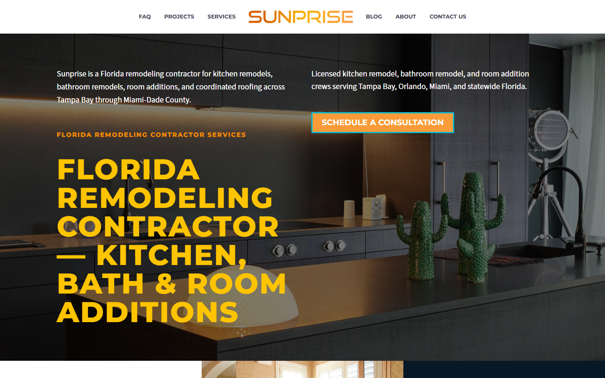
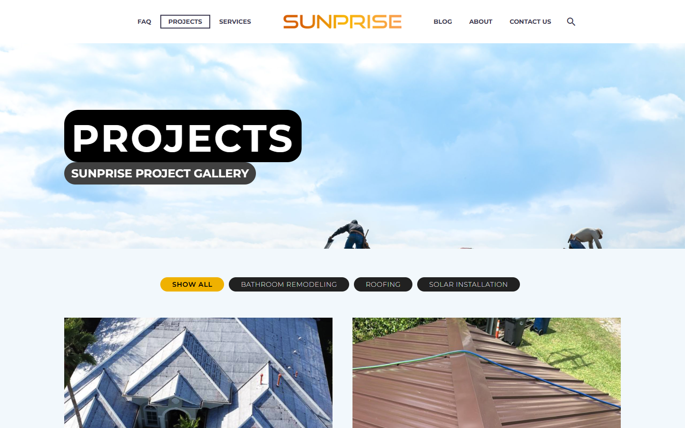
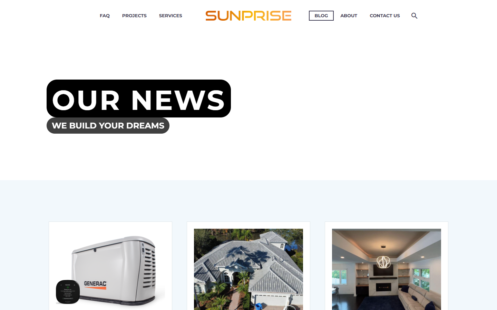
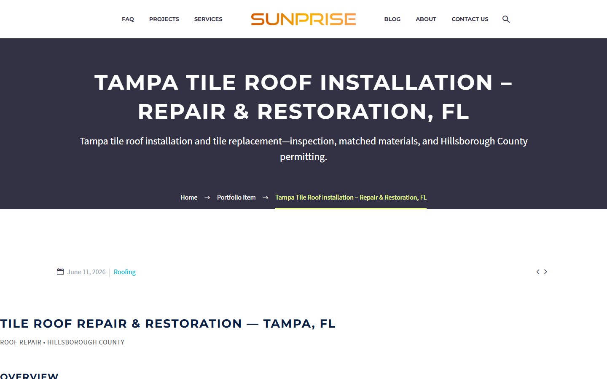
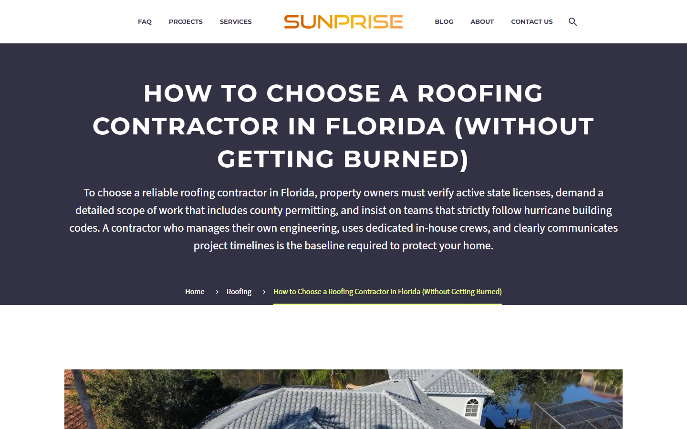
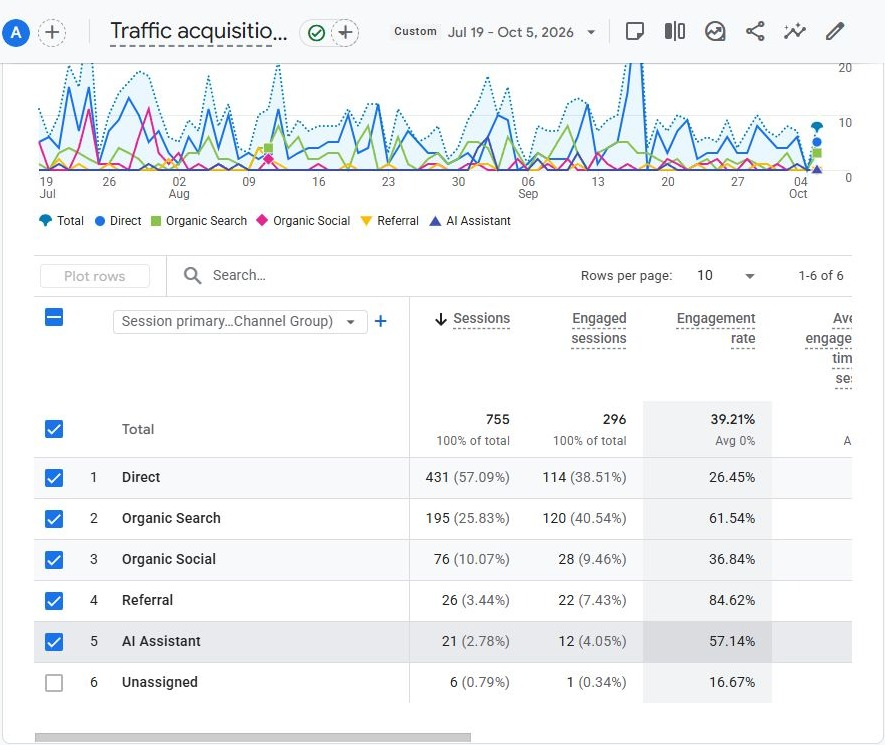
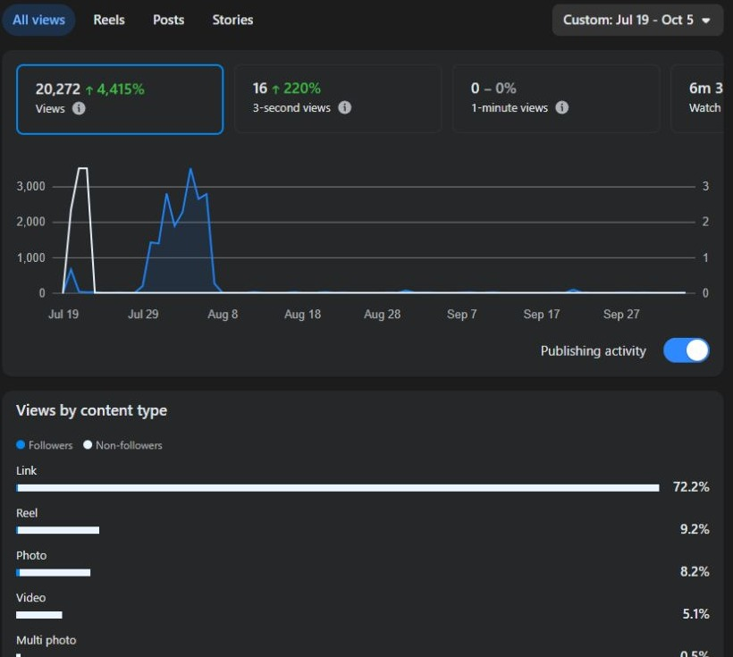
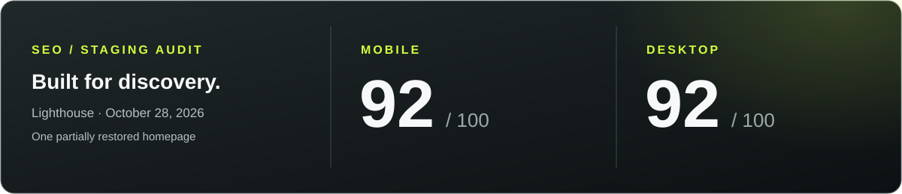

# Sunprise · migration, web & communications

I moved Sunprise’s business files, email and web presence onto a new platform stack, built its WordPress site, and configured the team’s phone system.

**2+ TB of files and data · approximately two weeks · no data, file or email loss · spreadsheets preserved**

<a href="https://rawpowered.github.io/Sunprise-WordPress-Case-Study/">Explore the case study</a> · <a href="#delivery">Delivery</a> · <a href="#measured-activity">Results</a> · <a href="docs/implementation.md">Technical detail</a>

---

## Delivery

- ✅ **Migrated 2+ TB of business files and data**, including images, contracts, PDFs and spreadsheets, alongside a substantial email transfer beyond OneDrive files.
- ✅ **Preserved data, files, email and spreadsheets** throughout the approximately two-week transition.
- ✅ **Moved the platform stack:** Microsoft 365 → Google Workspace; GoDaddy → Namecheap; Webflow → WordPress.
- ✅ **Resolved the final DNS cutover** through [DNS-Sentinel](https://github.com/RawPowered/DNS-Sentinel) diagnostics, provider support and phone coordination. Data transfer accounted for much of the schedule; GoDaddy DNS response time affected the final stretch.
- ✅ **Configured Zoom Phone** for multiple people, including call routing, menu logic and recordings.
- ✅ **Delivered a searchable contractor website** with service and location pages, project galleries, editorial content and analytics.

---

## The WordPress build

<table>
<tr>
<td width="33%" align="center" valign="top">
<h3>Pages</h3>

<strong>50 published records</strong> Service, location and company pages

</td>
<td width="33%" align="center" valign="top">
<h3>Blog Posts</h3>

<strong>13 published posts</strong> Roofing, remodeling and home systems

</td>
<td width="33%" align="center" valign="top">
<h3>Portfolio</h3>

<strong>30 published records</strong> Projects and detailed work narratives

</td>
</tr>
</table>

Archive inventory; page and portfolio totals include demo and operational records.

- ✅ Centered logo navigation and dedicated service and Florida location pages.
- ✅ Filterable project portfolio with individual project narratives.
- ✅ Image-led blog with practical roofing, remodeling and generator articles.
- ✅ Yoast metadata, canonical links, crawler guidance and a content index for LLMs.

<strong>Explore the project gallery and editorial layouts</strong>

 

 

---

## Measured activity

**WordPress reporting period: July 19-October 5, 2026**

| Google Analytics | Result | Facebook | Result |
| --- | ---: | --- | ---: |
| Active users | **639** | Content views | **20,272** |
| Sessions | **755** | Views attributed to link content | **72.2%** |
| Organic-search sessions | **195** | | |
| Engaged sessions | **296** | | |
| Page and screen views | **1,128** | | |

I also received quote inquiries by phone from businesses and residents who said they found Sunprise through organic Google searches, during a period that included paid promotions.

<strong>Inspect the analytics screenshots and measurement context</strong>

 

These figures cover the WordPress site. The earlier Webflow site had no comparable Google Analytics baseline. The new website and Facebook activity were requested within the last year; the longevity of earlier web-presence work cannot be established from the records. Facebook views are separate from website visits; Meta’s comparison percentage is not a before-and-after website comparison. Organic social includes multiple platforms.

---

## SEO implementation

- ✅ Service and location landing pages supported local discovery.
- ✅ The archive contains **37 Yoast title entries, 37 descriptions and 36 focus-keyword entries**: a restored article rendered a description and canonical URL.
- ✅ `robots.txt` supplied crawler rules and a sitemap reference; Yoast generated an `llms.txt` index.

**Audit scope:** The 92/100 scores are automated checks of a partially restored staging homepage. Page speed could not be reliably retested because hosting configurations differed. The `llms.txt` index needs editorial review and is separate from Lighthouse scoring. [Read the implementation notes](docs/implementation.md).

---

## Stack & related work

    

[TheGem](https://themeforest.net/item/thegem-creative-multipurpose-highperformance-wordpress-theme/16061685) · [Elementor](https://wordpress.org/plugins/elementor/) / [Pro](https://elementor.com/pro/) · [Slider Revolution](https://www.sliderrevolution.com/) · [LayerSlider](https://layerslider.com/) · [Yoast SEO](https://wordpress.org/plugins/wordpress-seo/) · [Site Kit](https://sitekit.withgoogle.com/) · [Contact Form 7](https://wordpress.org/plugins/contact-form-7/) · [WP Mail SMTP](https://wordpress.org/plugins/wp-mail-smtp/) · [Complianz](https://wordpress.org/plugins/complianz-gdpr/) · [Wordfence](https://wordpress.org/plugins/wordfence/)

[DNS-Sentinel](https://github.com/RawPowered/DNS-Sentinel) supported migration diagnosis. The later [Sunlectric theme](https://github.com/RawPowered/Sunlectric-Solar-WordPress-Showcase) drew inspiration from Sunprise’s centered navigation and solar presentation.

**Built by [Joseph Edwards](https://github.com/RawPowered).** This repository contains case-study materials and restored-site screenshots. Business files, personal data, databases and installable WordPress packages remain private. Third-party assets retain their owners’ terms; this showcase grants no reuse license.
