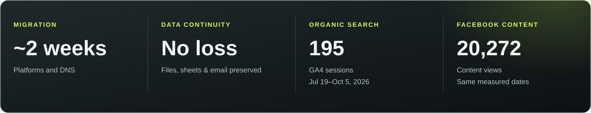
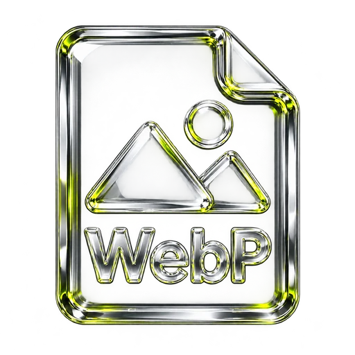

  

<strong>THE BUILD / PAGES · EDITORIAL · PROJECTS</strong>

<strong>50 published page records · 13 published blog posts · 30 published portfolio records</strong> Archived inventory; page and portfolio counts include demo and operational records.

<strong>MIGRATION / DELIVERY / MEASURED ACTIVITY</strong>

<strong>THE ORIGINAL BUILD / HOMEPAGE</strong>

  

<strong>THE WEBSITE / PROJECTS + EDITORIAL</strong>

  
  

<a href="https://rawpowered.github.io/Sunprise-WordPress-Case-Study/">Explore the case study</a> · <a href="#measured-activity">Measured activity</a> · <a href="#seo-and-content-strategy">SEO &amp; page speed</a> · <a href="#the-later-sunlectric-theme">Explore the related theme</a>

# Sunprise WordPress website

A case study by **Joseph Edwards ([RawPowered](https://github.com/RawPowered))** documenting the archived Sunprise WordPress build: its contractor-facing pages, project portfolio, blog, third-party tools, search structure, and approach to search and performance. The site covered remodeling, roofing, electrical work, insulation, generators, and solar services across Florida.

The website screenshots come from an isolated local restoration of the archived website. The original site used **TheGem** with Elementor and site-specific page layouts; the later Sunlectric theme is a separate project inspired in part by this work.

> **Showcase scope:** This case study contains screenshots and project documentation. The WordPress backup, database, theme and plugin packages, private operational integrations, and videos remain outside this repository.

---

## Challenge → action → outcome

Migrate Sunprise’s website, domain, and email from Microsoft 365, GoDaddy, and Webflow to Google Workspace, Namecheap, and WordPress—while resolving DNS errors and maintaining email continuity.

- ✅ **Delivered the migration in approximately two weeks**, with no emails lost.
- ✅ **Diagnosed DNS and mail issues** using [DNS-Sentinel](https://github.com/RawPowered/DNS-Sentinel), coordinating fixes through provider support and phone calls.
- ✅ **Configured Zoom Phone VoIP** for multiple people, managed call routing, and created call-menu logic and recordings.
- ✅ **Built a WordPress presence** with service and location pages, project galleries, a blog, and search-focused content.
- ✅ **Established measurement:** 195 organic-search sessions and 20,272 Facebook content views during the WordPress reporting period of July 19–October 5, 2026.
- ✅ **Received quote inquiries:** Businesses and residents called after finding Sunprise through organic Google searches, during a period that also included paid promotions.

---

## Website at a glance

- **Homepage and navigation:** A centered Sunprise wordmark and split navigation connect visitors to services, projects, the blog, FAQs, company information, and contact pages.
- **Service and location pages:** Dedicated pages organize remodeling, roofing, generators, insulation, electrical, solar, and Florida service areas around specific visitor needs.
- **Project portfolio:** A photographic project archive uses category filters and individual project pages with summaries and descriptions of the work.
- **Editorial system:** An image-led blog archive and individual articles cover topics such as roofing, remodeling, and backup power.
- **Search structure:** Service and location landing pages, Yoast metadata, descriptive article content, and canonical links are visible in the restored archive. These show implementation, not verified rankings or traffic results.
- **Media and motion:** Slider Revolution and LayerSlider are present in the active plugin record; the staging homepage restoration included the Slider Revolution slider and still posters.

The database export contains **50 published page records, 30 published portfolio records, and 13 published blog posts**. These are archive inventory counts; page and portfolio totals include demo or operational records and should not be read as counts of public destinations.

---

## Pages and presentation

<table>
  <tr>
    <td width="50%"> <strong>Project detail</strong> A project title, summary, breadcrumbs, and structured project narrative.</td>
    <td width="50%"> <strong>Article detail</strong> A featured image and practical roofing guidance in a structured article.</td>
  </tr>
</table>

[See the homepage, project archive, project detail, blog archive, and article in the case study](index.html).

---

## Technology and attribution

<table>
  <tr>
    <td align="center" width="50%"> <strong>WordPress</strong> Content, pages, posts, navigation, and site management</td>
    <td align="center" width="50%"> <strong>PHP</strong> WordPress theme and server-side site functionality</td>
  </tr>
  <tr>
    <td align="center"> <strong>HTML</strong> Page content, headings, and structured layouts</td>
    <td align="center"> <strong>CSS</strong> Responsive presentation and visual styling</td>
  </tr>
  <tr>
    <td align="center"> <strong>JavaScript</strong> Interactive site components and media</td>
    <td align="center"> <strong>Web media</strong> Image-led pages, portfolio, and slider presentation</td>
  </tr>
</table>

The archived active-plugin record identifies the following products. Links credit their creators; inclusion in the active set alone does not establish that every visible feature used a particular plugin.

| Role | Theme or plugins |
| --- | --- |
| Theme and visual editing | [TheGem by CodexThemes](https://themeforest.net/item/thegem-creative-multipurpose-highperformance-wordpress-theme/16061685) (version 5.12.2 in the backup), [Elementor](https://wordpress.org/plugins/elementor/), [Elementor Pro](https://elementor.com/pro/) |
| Media and motion | [Slider Revolution](https://www.sliderrevolution.com/), [LayerSlider](https://layerslider.com/) |
| Search and analytics | [Yoast SEO](https://wordpress.org/plugins/wordpress-seo/), [Google Site Kit](https://sitekit.withgoogle.com/) |
| Forms and email | [Contact Form 7](https://wordpress.org/plugins/contact-form-7/), [WP Mail SMTP](https://wordpress.org/plugins/wp-mail-smtp/) |
| Consent and security | [Complianz](https://wordpress.org/plugins/complianz-gdpr/), [Wordfence](https://wordpress.org/plugins/wordfence/) |

Original page layouts, portfolio organization, content structure, and private operational integrations were built alongside these third-party tools. Premium packages, private code, and licensed media remain subject to their owners’ terms.

---

## Measured activity

From **July 19 through October 5, 2026**, the first and last dates with recorded sessions in the Google Analytics report reviewed from January 2025 through October 28, 2026, the property recorded:

| Website activity · Google Analytics | Result |
| --- | ---: |
| Active users | **639** |
| Page and screen views | **1,128** |
| Sessions | **755** |
| Engaged sessions | **296** (39.21% of sessions) |
| Organic search sessions | **195** (25.83% of sessions) |
| Organic social sessions | **76** (10.07% of sessions) |
| AI assistant sessions | **21** (2.78% of sessions) |

During the **same dates**, Facebook reported **20,272 content views**, of which **72.2%** were attributed to link content. These are Facebook content views, not visits to the website or unique people; the dashboard does not establish how much was paid or organic. Google Analytics’ organic social category covers multiple social platforms and should not be treated as a count of Facebook referrals.

<table>
  <tr>
    <td width="50%"> <strong>Google Analytics</strong> Session acquisition and engagement by channel.</td>
    <td width="50%"> <strong>Facebook Insights</strong> Content views and content-type breakdown.</td>
  </tr>
</table>

**Measurement context:** These figures cover the WordPress site. The earlier Webflow site was not connected to Google Analytics, so a comparable before-and-after baseline is unavailable. Facebook content views are separate from website visits; the screenshot’s comparison percentage is Meta’s platform comparison. The new website and Facebook activity were requested within the last year, and the duration of earlier web-presence work cannot be established from the available records.

---

## SEO and content strategy

The archived build organized search-focused content around the services homeowners might need and the places they might need them. The work visible in the restoration includes:

- **Service landing pages:** Dedicated pages for remodeling, roofing, electrical, insulation, generators, and solar create distinct paths into the site. The homepage highlights those services and links visitors to deeper content.
- **Local discovery:** Florida service-area pages and location references connect the site’s services to specific markets. These pages document the site’s geographic content strategy; the archive does not establish their search rankings.
- **Helpful editorial content:** Blog articles answer homeowner questions about roofing, remodeling, and generators. The restored roofing article uses a descriptive title and summary followed by sections on evaluation, red flags, and construction standards.
- **On-page metadata:** The backup contains **37 Yoast title entries, 37 description entries, and 36 focus-keyword entries**. These are database entry counts, not a count of optimized public pages. One restored roofing article was verified to render a meta description and canonical URL.
- **Content navigation:** The menu, project archive, article cards, breadcrumbs, and links between the homepage and service pages help connect related content and provide paths through the site.
- **Crawler guidance:** The archived `robots.txt` disallowed the WordPress administration area, includes directory, and XML-RPC endpoint while allowing the AJAX endpoint; it also advertised the sitemap index. These directives guide cooperative crawlers and are not access controls.
- **AI-readable content index:** The archived `llms.txt`, generated by Yoast SEO, lists pages, posts, portfolio items, categories, and a sitemap link for language-model consumption. Its entries included operational and template pages and inconsistent URLs, so the index would need review before reuse. Its presence is not evidence of a Lighthouse SEO benefit or AI search visibility.
- **Tools:** [Yoast SEO](https://wordpress.org/plugins/wordpress-seo/) and [Google Site Kit](https://sitekit.withgoogle.com/) appear in the archive’s active-plugin record. Their presence alone does not establish traffic or ranking results.

### SEO audit snapshot

The partially restored staging homepage received a **92/100 Lighthouse SEO score on mobile and 92/100 on desktop** in a PageSpeed Insights test on **October 28, 2026**. These are automated checks of that staging page, not historical scores for the original live site, proof of search rankings, or a comprehensive SEO audit. The test environment and restoration differed from production, including missing slider videos. Metadata, canonical links, and crawlability are relevant technical SEO practices observed in the project; the available report does not establish which individual changes caused the score. `llms.txt` is documented as a separate AI-oriented index, not a Lighthouse scoring factor.

---

## Page speed

Page speed could not be reliably re-tested for the former live site because the test environment used a different hosting configuration. The staging restoration was also incomplete and did not include the original slider videos. No historical production speed result is claimed.

---

## The later Sunlectric theme

The separate [Sunlectric theme showcase](https://github.com/RawPowered/Sunlectric-Solar-WordPress-Showcase) draws inspiration from elements of this work, including the centered logo navigation and solar presentation. It is a later rebranded theme project, not the original Sunprise WordPress build documented here.

---

## Project status and source boundaries

This repository is a visual case study and does not include an installable WordPress site. The original WordPress backup and full source remain private; this case study does not grant a license to use the theme, plugins, images, or underlying site.

- [Open the Sunprise case study](index.html)
- [View the Sunlectric theme showcase](https://github.com/RawPowered/Sunlectric-Solar-WordPress-Showcase)
- [Joseph Edwards on GitHub](https://github.com/RawPowered)

Design and development by [Joseph Edwards](https://github.com/RawPowered). Third-party names and marks belong to their respective owners.
